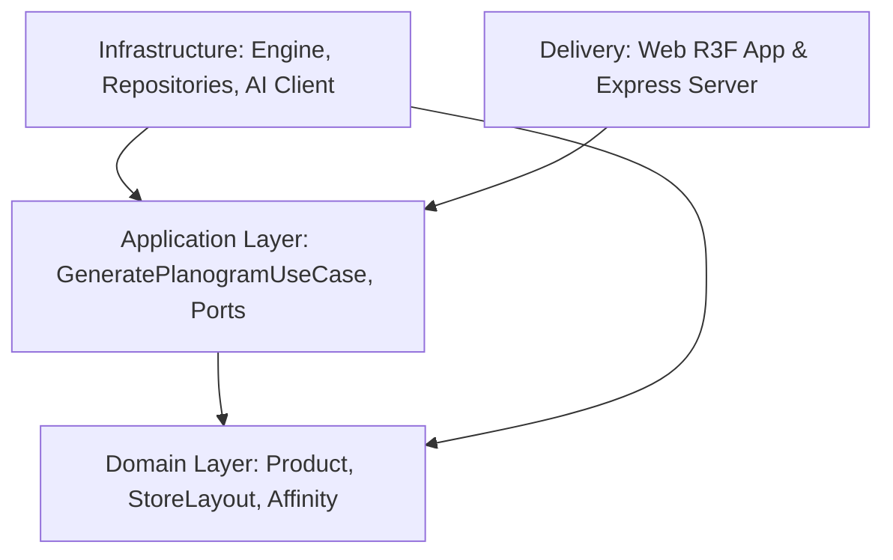

# 🏛️ tiend3o Architecture & System Design

`tiend3o` is an enterprise-grade 3D retail space planning and planogram optimization platform built with TypeScript, React Three Fiber, Node.js, and Anthropic Claude.

It strictly adheres to **Clean Architecture** and **Domain-Driven Design (DDD)** principles to separate business rules from visualization and delivery mechanisms.

---

## 🧩 Monorepo Structure

```text
tiend3o/
├── packages/
│   ├── core/                  # Clean Architecture: Store Domain & Planogram Engine
│   │   └── src/
│   │       ├── domain/        # Entities, Value Objects, Repository Interfaces
│   │       ├── application/   # Use cases, DTOs, Ports
│   │       ├── infrastructure/# In-memory & DB repositories, Heuristic placement engine
│   │       └── shared/        # Domain errors, Result<T, E>
│   │
│   └── shared/                # Universal spatial schemas, grid math, and bounds calculation
│       └── src/
│           ├── schema.ts      # Zod validation schemas & types
│           ├── grid.ts        # Procedural store discretization & aisle routing
│           └── bounds.ts      # Pure math bounding-box normalization
│
├── apps/
│   ├── web/                   # 3D Store Visualizer & Planogram Studio
│   │   └── src/
│   │       ├── scene/         # Three.js & React Three Fiber components
│   │       ├── ui/            # TailwindCSS HUD & product inspector
│   │       └── store/         # Zustand state management
│   │
│   └── server/                # Express API & Anthropic Claude Integration
│       └── src/
│           ├── infrastructure/
│           │   ├── ai/        # Claude Sonnet 4 client & prompt engineering
│           │   └── inference/ # 10-year market basket affinity engine
│           └── app.ts         # REST API endpoints
│
└── docs/                      # Technical specifications & domain guides
```

---

## 🎯 Clean Architecture Dependency Flow



### 1. Domain Layer (`packages/core/src/domain`)
- **Entities**:
  - `ProductEntity`: Encapsulates SKU, dimensions, sales velocity, margin, and placement priority formulas.
  - `StoreLayoutEntity`: Represents the store footprint, aisles, gondolas, shelves, and slot assignments.
- **Value Objects**:
  - `AffinityScore`: Encapsulates Support, Confidence, and Lift metrics for co-purchased items.
- **Repositories (Contracts)**:
  - `IProductRepository`, `IStoreLayoutRepository`, `IAffinityRepository`.

### 2. Application Layer (`packages/core/src/application`)
- **Use Cases**:
  - `GeneratePlanogramUseCase`: Coordinates layout generation, catalog retrieval, and optimal slotting.
- **Ports**:
  - `IPlanogramOptimizerPort`: Decouples the placement algorithm (heuristic vs AI-driven).

### 3. Infrastructure Layer (`packages/core/src/infrastructure`)
- **Heuristic Engine**:
  - Implements eye-level revenue maximization: places high-velocity, high-margin products on levels 1 and 2 (eye and touch levels) and clusters complementary categories (e.g., Dairy + Bakery).
- **AI Integration (`apps/server/src/infrastructure/ai`)**:
  - Claude Sonnet 4 integration for strategic qualitative merchandising recommendations.

---

## ⚡ 3D Graphics Performance Patterns

1. **`StaticMerge.tsx`**:
   - Thousands of shelf and gondola divider meshes are automatically combined into single draw calls per material.
   - Prevents GPU draw-call bottlenecks on dense supermarket scenes with >1,000 product slots.

2. **`modelBounds.ts` & `fitModel.ts`**:
   - Automatically computes bounding boxes (`Box3`) and scales any 3D asset (`.glb`) to exact real-world centimetre dimensions, ensuring cartons of milk, bottles, and boxes fit cleanly on shelf rails.
